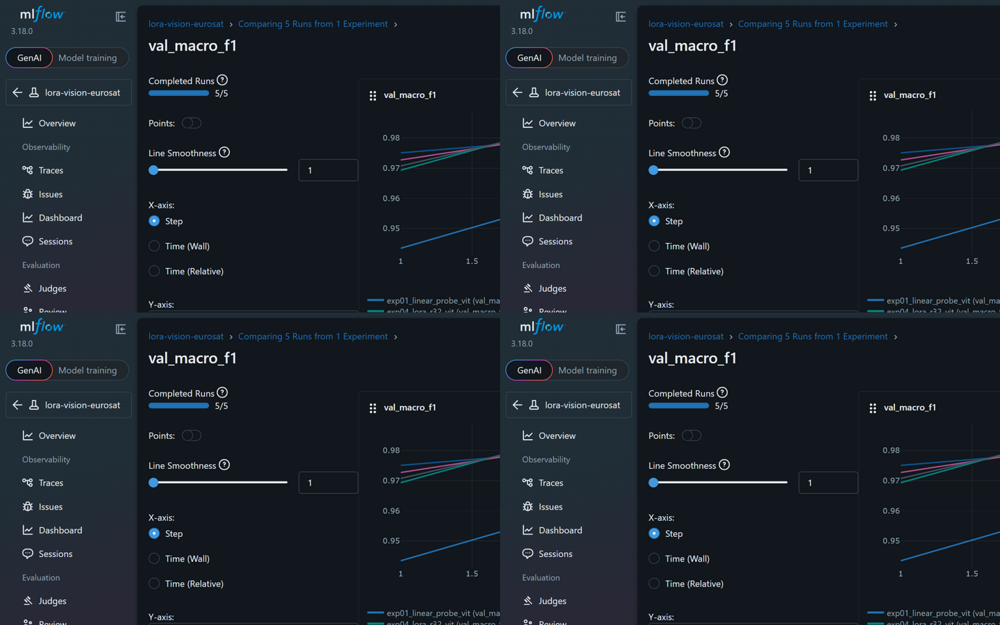
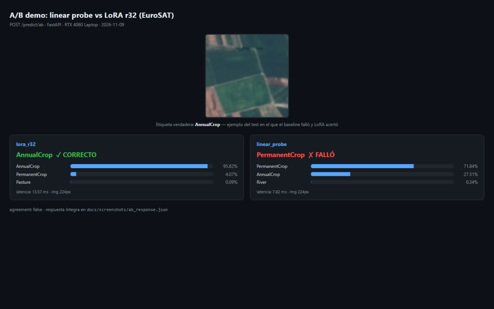
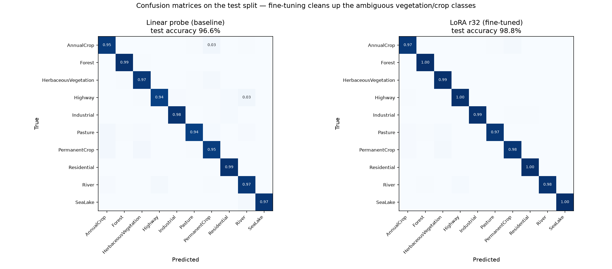
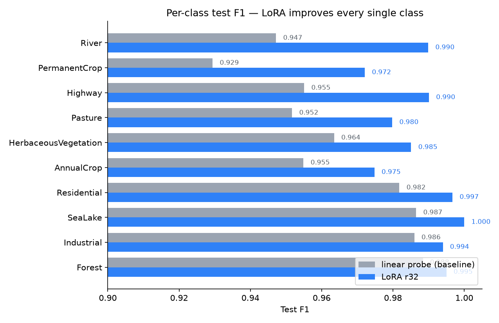
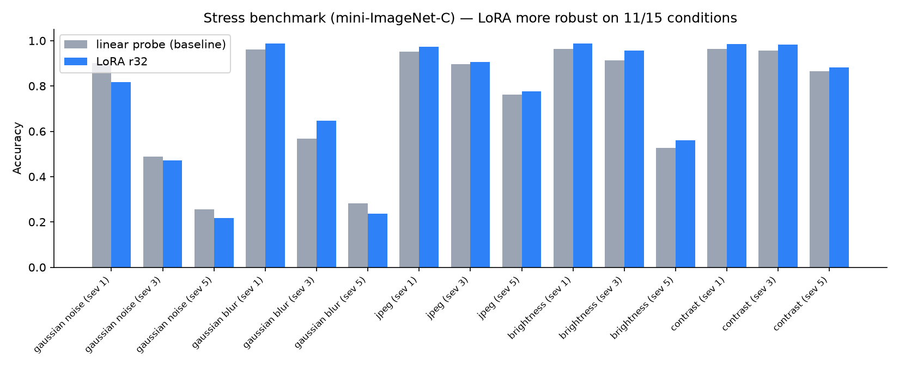
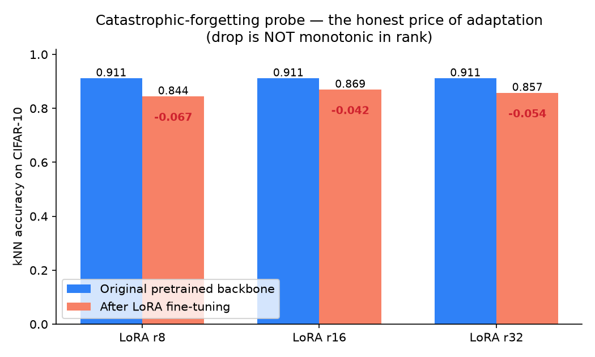

# LoRA Vision Fine-Tuning Pipeline

Fine-tune open-source vision backbones with **LoRA** on a domain-specific dataset, and
prove the improvement with a rigorous, reproducible evaluation stack — then serve the
result behind an A/B comparison API.

> **Headline:**
> *"I fine-tuned ViT-B/16 with LoRA on EuroSAT satellite imagery and improved test
> macro-F1 from 96.4% (linear-probe baseline) to 98.8% — a paired exact-binomial
> p ≈ 1e-12 — while training only 3.3% of the parameters (rank 8 matches it at
> 0.9%), and I quantified the price: a −4/−7 point drop on a CIFAR-10 kNN probe
> that doesn't scale with rank. Full report with every claim traced to artifacts."*

Instead of a 7B-parameter language model, it fine-tunes **ViT-B/16** (LoRA on the
MLP projections of every encoder layer) and **ResNet-50** (LoRA on the 1×1
bottleneck convolutions) on satellite imagery — the same parameter-efficient
lifecycle used for LLMs, sized to run on a laptop or a single consumer GPU.

---

## What this project demonstrates

Fine-tuning is where AI engineering meets ML engineering. This project covers the
full model-customization lifecycle end to end: dataset governance (frozen manifests,
no leakage), baseline-first evaluation, a hyperparameter sweep with experiment
tracking, a distribution-shift stress benchmark, a catastrophic-forgetting probe,
and packaging for deployment — all config-driven and reproducible from a single YAML.

## What's inside

| Stage | Implementation |
|---|---|
| Phase 1 — build the dataset | `scripts/prepare_data.py`: download → materialize → stratified 80/10/10 manifests (seeded, frozen) |
| Phase 2 — training pipeline | `vision_pipeline/training/`: LoRA via PEFT, dual LR, warmup+cosine, AMP, early stopping, checkpoints, MLflow + CSV logging |
| Phase 3 — evaluate & compare | `scripts/evaluate.py` (test + stress), `scripts/compare.py` (head-to-head + exact binomial test), `scripts/run_forgetting.py` (feature drift + kNN) |
| Phase 4 — inference pipeline | `vision_pipeline/serving/`: FastAPI with `/predict` and `/predict/ab`, latency/throughput benchmark |
| Phase 5 — containerize & document | `Dockerfile`, `docker-compose.yml`, `reports/EXPERIMENT_REPORT.md` |
| Phase 6 — report & demo | `docs/screenshots/`, A/B demo API, every claim traced to `outputs/` artifacts |

## Architecture

```
                    ┌──────────────────────────────────────────────┐
                    │                 configs/*.yaml               │
                    │        (one YAML = one reproducible run)     │
                    └──────────────────────┬───────────────────────┘
                                           │
  data/raw/<ds>/ ──► stratified splits ──► │
  (materialized)    train/val/test.json    │
                    frozen manifests       ▼
                              ┌─────────────────────────┐
                              │      Trainer (PEFT)     │
                              │ ViT-B/16 + LoRA(FFN)    │
                              │ ResNet50 + LoRA(1x1)    │
                              │ or linear-probe baseline│
                              └───────┬─────────────────┘
                                      │ best.pt + adapter/ + meta.json
                     ┌────────────────┼───────────────────────┐
                     ▼                ▼                       ▼
             evaluate.py         compare.py            serve.py (FastAPI)
         clean + stress      base vs LoRA,           /predict  /predict/ab
         benchmark           binomial test           + benchmark_inference
                     └────────────────┼───────────────────────┘
                                      ▼
                    forgetting.py (feature drift + kNN on CIFAR-10)
```

## Quickstart

Requires Python 3.11+. GPU optional (ResNet runs fine on CPU; ViT is slow on CPU).

```bash
# 1. Environment (Windows Git Bash shown; on POSIX use .venv/bin/activate)
python -m venv .venv
source .venv/Scripts/activate

# NVIDIA GPU on Windows: install CUDA wheels FIRST (PyPI default = CPU-only on Windows).
# cu126 works for Python 3.11-3.13 and torch >= 2.6. If it fails, grab the current
# command from https://pytorch.org (Get Started -> your OS/CUDA version).
pip install torch torchvision --index-url https://download.pytorch.org/whl/cu126

# then everything else (torch/torchvision already satisfied, skipped)
pip install -r requirements.txt
pip install -e .   # installs the vision_pipeline package in editable mode

# sanity check: must print "cuda: True"
python -c "import torch; print('cuda:', torch.cuda.is_available())"

# 2. Dataset: download EuroSAT, materialize files, build frozen stratified manifests
python scripts/prepare_data.py --config configs/base.yaml

# 3. Baseline first, then the best LoRA run
python scripts/train.py --config configs/experiments/exp01_linear_probe_vit.yaml
python scripts/train.py --config configs/experiments/exp04_lora_r32_vit.yaml

# 4. Full sweep (ranks 8/16/32 + ResNet LoRA) — writes outputs/sweep/sweep_results.md
python scripts/sweep.py --configs exp01_linear_probe_vit exp02_lora_r8_vit \
    exp03_lora_r16_vit exp04_lora_r32_vit exp05_lora_r16_resnet

# 5. Evaluation stack
python scripts/evaluate.py --run-dir outputs/exp04_lora_r32_vit          # clean + stress
python scripts/compare.py --run-a outputs/exp01_linear_probe_vit \
                           --run-b outputs/exp04_lora_r32_vit            # head-to-head
python scripts/run_forgetting.py --run-dir outputs/exp04_lora_r32_vit    # forgetting probe

# 6. Inference quality-of-service
python scripts/benchmark_inference.py --run-dir outputs/exp04_lora_r32_vit

# 7. A/B demo API
python scripts/serve.py --models "lora_r32=outputs/exp04_lora_r32_vit,linear_probe=outputs/exp01_linear_probe_vit"
# then: POST /predict/ab with an image; GET /health

# Tests (offline, CPU, no downloads)
python -m pytest -v

# Docker (inference + MLflow UI)
docker compose up --build
```

## Datasets

| Dataset | Classes | Images | Notes |
|---|---|---|---|
| **EuroSAT** (default) | 10 | 27,000 | Sentinel-2 land-use tiles (64px). Clean, small, very measurable. |
| CIFAR-10 | 10 | 60,000 | classic; materialized to PNG once |
| Oxford Flowers-102 | 102 | 8,189 | fine-grained; harder task |

Switch with `data.name` in the YAML. EuroSAT caveat (documented, not hidden): tiles come
from overlapping Sentinel-2 scenes, so random splits can share scenes between train and
test. This is the standard protocol for comparability; a scene-aware split is a
listed extension.

## Key design decisions

1. **What is the "base model" baseline?** With a random 10-class head, the raw pretrained
   model scores chance. The honest baseline is **linear probing** (frozen backbone +
   trained head) — the standard protocol in transfer-learning literature. LoRA is the
   treatment; compare.py quantifies the delta with a paired exact binomial test.
2. **LoRA targets per backbone — a real bug found, root-caused and fixed.** The first
   sweep trained three ViT LoRA runs *identical to the linear-probe baseline to 16
   decimal places*. Root cause: torchvision's ViT uses `nn.MultiheadAttention`, whose
   `F.multi_head_attention_forward` applies the output projection on the raw weight
   **tensors** (`linear(x, out_proj.weight, out_proj.bias)`) — it never calls
   `out_proj.forward()`, so a LoRA wrapper there is dead code (verified: forward hooks
   fire 0 times, lora_B gradients are exactly 0.0). The fix targets the MLP projections
   `mlp.0`/`mlp.3` (24 adapters — the FFN, same idea as fc1/fc2 LoRA targets for HF
   ViTs), with a regression test asserting adapters actually fire in forward and
   receive gradients. ResNet: the 1×1 convs of every Bottleneck (`conv1`/`conv3` → 32
   adapters for ResNet-50; ResNet-18's BasicBlock adapts its 8 `conv1`). Stem and
   downsample convs stay frozen.
3. **The BatchNorm trap.** Frozen BN layers still update running statistics in
   `train()` mode even with `requires_grad=False`. `configure_train_mode` forces every
   non-adapted module to `eval()` — silently skipping this *would have corrupted the
   baseline*. Verified by a dedicated test.
4. **`modules_to_save=["head"]`.** The fresh classification head must train and be saved
   with the adapter. Name collision subtlety: torchvision's ViT MLP layers are
   `fc1`/`fc2`, so `head` only matches the classifier.
5. **Data governance.** Splits are frozen JSON manifests written *before* training;
   the test manifest is only read by final-reporting scripts. Every run directory
   stores its resolved config (`meta.json`) + config hash.
6. **Robustness, not just clean accuracy.** A mini-ImageNet-C (5 corruptions × 5
   severities, never seen in training augmentation) measures whether fine-tuning
   improved OOD behavior or memorized the clean split.
7. **Forgetting, measured.** Paired feature drift (cosine distance) + kNN accuracy on
   CIFAR-10 (disjoint domain) for base vs adapted backbone — the vision analogue of
   running general benchmarks after an LLM fine-tune.
8. **Deployment artifact.** LoRA saves the PEFT adapter (~MBs) next to the full state;
   serving loads base + adapter, enabling multi-domain adapters over one base.

## Config reference (main fields)

| Field | Default | Meaning |
|---|---|---|
| `model.backbone` | `vit_b_16` | `vit_b_16` \| `resnet50` \| `resnet18` |
| `model.method` | `lora` | `lora` \| `linear_probe` (baseline) |
| `lora.rank` / `alpha` | 16 / 32 | capacity; alpha = 2×rank convention |
| `train.lr` / `train.head_lr` | 2.0e-4 / 1.0e-3 | adapters vs fresh head |
| `train.epochs` + early stopping | 5, patience 3 | val macro-F1 gates stopping |
| `train.max_steps_per_epoch` | null | smoke runs / debugging |
| `data.name` | `eurosat` | `eurosat` \| `cifar10` \| `flowers102` |
| `tracking.backend` | `mlflow` | SQLite store (`sqlite:///mlflow.db`); `none` to disable. Browse runs: `mlflow ui --backend-store-uri sqlite:///mlflow.db` |

## Results (EuroSAT, 2,700-image test split, final-reporting only)


*All 5 runs compared in MLflow: the linear probe plateaus at ~0.96 while every LoRA variant converges to ~0.986 — visible in one glance.*


*A/B inference (`POST /predict/ab`): on this AnnualCrop tile the linear probe says PermanentCrop (71.8%) while the LoRA model says AnnualCrop (95.8%) — exactly the class confusion the fine-tune fixed.*


| Config | Trainable params | val macro-F1 | test acc | test macro-F1 | train (min) |
|---|---|---|---|---|---|
| exp01 linear probe (ViT, baseline) | 7,690 (0.009%) | 96.26% | 96.56% | 96.44% | 8.9 |
| exp02 LoRA r8 (ViT) | 744,970 (0.861%) | 98.69% | **98.70%** | **98.65%** | 19.6 |
| exp03 LoRA r16 (ViT) | 1,482,250 (1.698%) | 98.65% | 98.48% | 98.44% | 19.4 |
| exp04 **LoRA r32 (ViT)** | 2,956,810 (3.331%) | 98.69% | **98.81%** | **98.78%** | 19.6 |
| exp05 LoRA r16 (ResNet-50) | 592,906 (2.458%) | 98.67% | 98.26% | 98.19% | 10.4 |


*Test errors drop from 93 to 32; the wins concentrate in the ambiguous vegetation/crop classes.*


*LoRA improves every single class; largest gains exactly where the baseline struggled (PermanentCrop +4.3, River +4.3, Highway +3.5 F1 points).*

Key findings:

- **LoRA beats the frozen-backbone baseline by +2.3 F1 points** (96.44% → 98.78%) —
  adapting the FFN adds real capacity exactly where the domain shift lives.
- **Rank-insensitivity**: r8 (0.86% params) already reaches 98.65% test F1 — within
  noise of r32. Classic LoRA behavior; the sweep table is the evidence.
- ResNet-50 with conv-LoRA lands at 98.19%, showing the same idea transfers to CNNs
  with 10× less training time.
- **The improvement is statistically significant**: on the same 2,700 ordered test
  images, LoRA fixed 73 baseline errors and regressed on 12 — exact binomial
  **p ≈ 1e-12** (`outputs/compare/…/report.md`).
- **Robustness (mini-ImageNet-C, corruptions unseen in training)**: mean stress
  accuracy 75.05% → 75.91%. Better on blur/JPEG/brightness/contrast at every
  severity; slightly worse under heavy gaussian noise — fine-tuning is not
  automatically more robust.

  

- **The forgetting probe kills the "LoRA is free" myth** at this configuration:
  CIFAR-10 kNN drops −6.7 / −4.2 / −5.4 points for r8/r16/r32 — the FFN adaptation
  itself, not its capacity, drives the drift. Quantified in
  `outputs/*/forgetting/report.md`.

  
- Full artifacts per claim: `outputs/sweep/sweep_results.md`, per-run
  `eval/` + `forgetting/` directories, `outputs/benchmarks/`.
  `outputs/` and trained weights are gitignored — everything is regenerable from the
  Quickstart above; this report and the figures capture every number.

## Repo layout

```
configs/            base.yaml + 5 experiment YAMLs (inheritance)
src/vision_pipeline/
  config.py         typed YAML config + inheritance + validation
  data/             materialization, manifests, transforms
  models/           backbone factory, Classifier, LoRA wiring
  training/         metrics (from scratch), tracker, Trainer, run, sweep
  evaluation/       corruptions, evaluate, compare, forgetting probe
  serving/          FastAPI app (/predict, /predict/ab)
scripts/            CLI entry points (prepare, train, sweep, evaluate, compare,
                    forgetting, benchmark, serve)
tests/              offline pytest suite incl. end-to-end training smoke test
reports/            experiment report template
```

## Requirements

- Python 3.11+, ~4 GB disk (weights + datasets)
- GPU: any 4 GB+ NVIDIA card makes ViT runs minutes instead of an hour; everything
  falls back to CPU
- First run downloads: EuroSAT (~90 MB), ViT-B/16 ImageNet weights (~340 MB),
  ResNet-50 weights (~100 MB), CIFAR-10 for the forgetting probe (~170 MB)

## Extensions / roadmap

- Scene-aware EuroSAT split (kill the leakage caveat)
- ONNX export + TensorRT benchmark
- LoRA on more blocks (key, MLP) and rank-sensitivity curves
- W&B backend alongside MLflow

## Tech stack

PyTorch · torchvision · Hugging Face PEFT · MLflow · FastAPI · pytest · Docker
